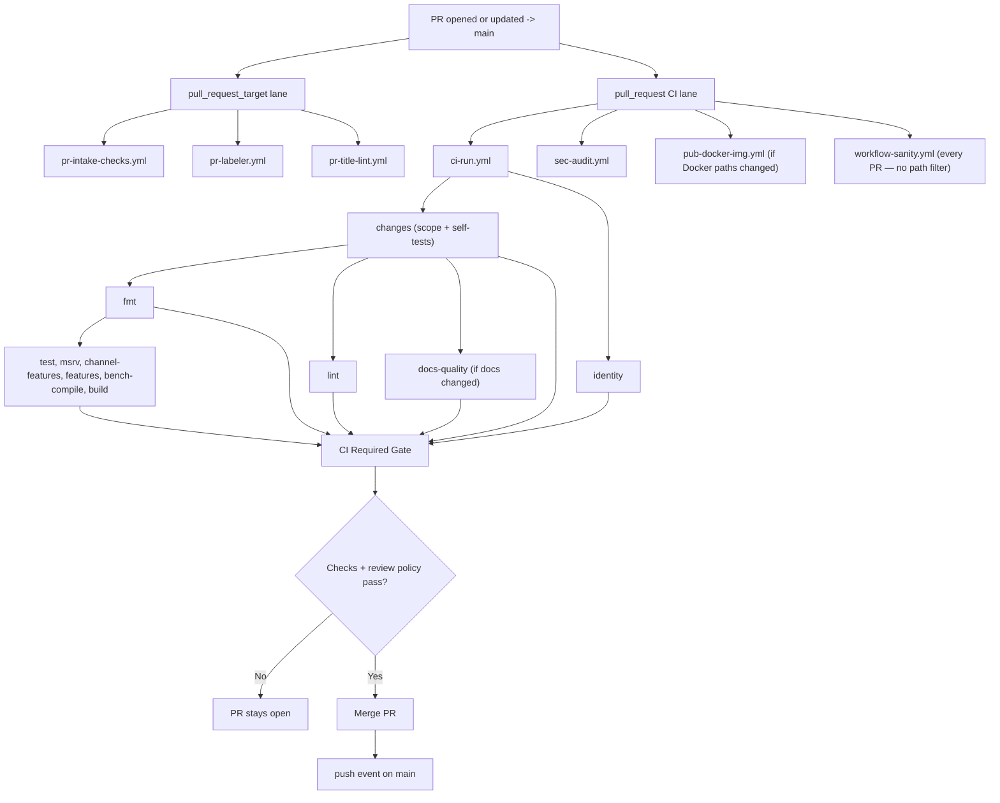
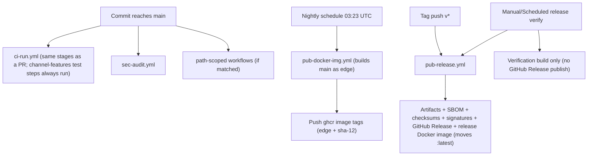

# Main Branch Delivery Flows

This document explains what runs when code is proposed to `main`, merged into `main`, and released.

Use this with:

- [`docs/contributing/ci-map.md`](../../docs/contributing/ci-map.md)
- [`docs/contributing/pr-workflow.md`](../../docs/contributing/pr-workflow.md)
- [`docs/contributing/release-process.md`](../../docs/contributing/release-process.md)

## Event Summary

| Event | Main workflows |
| --- | --- |
| PR activity (`pull_request_target`) | `pr-intake-checks.yml`, `pr-labeler.yml`, `pr-title-lint.yml` |
| PR activity (`pull_request`) | `ci-run.yml`, `sec-audit.yml` (no path filter on PRs); `pub-docker-img.yml` only when its Dockerfile paths change; `workflow-sanity.yml` on every PR (no path filter) |
| Push to `main` | `ci-run.yml`, `sec-audit.yml` (path-scoped on `Cargo.toml`, `Cargo.lock`, `src/**`, `crates/**`, `deny.toml`), `workflow-sanity.yml` (path-scoped on `.github/workflows/**`, `.github/*.yml`, `.github/*.yaml`) |
| Tag push (`v*`) | `pub-release.yml` publish mode (publishes the GitHub Release and a multi-arch Docker image, and moves `:latest`) |
| Scheduled/manual | `pub-release.yml` verification mode, `pr-labeler.yml` (manual only, in audit or repair mode for managed labels), `pub-docker-img.yml` (nightly build of `main` as `:edge`), `sec-codeql.yml`, `test-fuzz.yml`; `sec-audit.yml` also runs on a weekly schedule (Monday 06:00 UTC), with no manual trigger |

## Step-By-Step

### 1) PR -> `main`

1. Contributor opens or updates a PR against `main`.
2. `pull_request_target` automation runs:
   - `pr-intake-checks.yml` posts intake warnings/errors.
   - `pr-labeler.yml` sets size/risk/scope labels.
   - `pr-title-lint.yml` validates the Conventional Commits PR title.
3. `pull_request` CI workflows start:
   - `ci-run.yml` (consolidated Rust quality gate) — every PR
   - `sec-audit.yml` — every PR (the `pull_request` trigger is intentionally unfiltered, because a required check that does not report on a PR leaves it pending forever)
   - path-scoped workflows when matching files changed:
     - `pub-docker-img.yml` — Dockerfile build-input paths only
   - `workflow-sanity.yml` — every PR (the `pull_request` trigger is intentionally unfiltered for the same reason as `sec-audit.yml`)
4. In `ci-run.yml`, `changes` ("Detect Change Scope") first runs five self-tests. They cover the change-scope script, the filtered lib-test wrapper, the installer's tamper handling, the shared clippy JSON gates, and the workflow's cache and profile policy. It then runs `scripts/ci/detect_change_scope.sh`, which writes seven outputs. The job exposes six of them:
   - `docs_only`
   - `docs_changed`
   - `rust_changed`
   - `channel_features_changed`
   - `docs_files`
   - `base_sha`

   The script also writes `workflow_changed`, which the job does not expose.
5. `identity` runs on every event, with no `needs:` and no scope condition.
6. Rust path stages:
   - `fmt` (needs `changes`; runs when `rust_changed` is true) runs `cargo fmt --all -- --check`.
   - `lint` (needs only `changes`; runs when `rust_changed` is true) runs clippy once, feeds the JSON to the quality gate (`--skip-fmt`) and to the strict delta gate on changed lines, then runs the source-level guards and doc-coverage checks.
   - `test`, `msrv`, `channel-features`, `features`, `bench-compile` and `build` each need `[changes, fmt]` and run only when `rust_changed` is true and `fmt` succeeded. They do not wait for `lint`.
   - `test` runs `cargo test --locked --workspace -- --test-threads=1`. This includes the `agent_e2e` integration target, so there is no separate `e2e` job.
   - `msrv` checks every target at the declared minimum Rust version.
   - `channel-features` is one job with three test and check steps. The steps run on every push and on a PR only when `channel_features_changed` is true. On a PR that does not touch channel code, the job reports success with those steps skipped.
   - `features` is one job with three sequential steps: `cargo check` for `no-default-features`, `observability-otel` and `kb-office`. It is not a matrix.
   - `bench-compile` runs `cargo bench --no-run --locked`.
   - `build` runs a `release-fast` smoke build and the binary-size guard.
7. Fast-path jobs: `docs-only` runs when `docs_only` is true, and `non-rust` runs when the change is neither docs-only nor Rust.
8. Docs path: `docs-quality` runs when `docs_changed` is true. It runs incremental markdownlint on changed lines, the CLI command and HTTP route doc-coverage checks, the channel maturity check, and an offline lychee check on added links.
9. `lint-feedback` runs on PRs only. It reads the results of `lint` and `docs-quality` and posts an actionable failure comment if either failed.
10. `CI Required Gate` runs `scripts/ci/required_gate.sh` and aggregates results to a final pass or fail. The gate checks in this order:
    - `identity` must be `success`.
    - `changes` must be `success`, because every scope output is empty when it did not finish.
    - `docs-quality` must be `success` when `docs_changed` is true.
    - When `docs_only` is true, or `rust_changed` is not true, the gate passes on a fast path.
    - Otherwise `fmt`, `lint`, `test`, `msrv`, `channel-features`, `features`, `bench-compile` and `build` must all be `success`. A `skipped` result blocks.
11. Maintainer merges PR once checks and review policy are satisfied.
12. Merge emits a `push` event on `main` (see scenario 2).

### 2) Push to `main` (including after merge)

1. Commit reaches `main`.
2. `ci-run.yml` runs on `push`. `changes` diffs against the commit before the push, and the Rust stages follow the same `rust_changed` and `fmt` conditions as on a PR (no `ci:full` requirement). The only difference in which Rust stages run is that the `channel-features` test and check steps always run on a push.
3. `sec-audit.yml` runs on `push` when `Cargo.toml`, `Cargo.lock`, `src/**`, `crates/**` or `deny.toml` changed.
4. Path-filtered workflows run only if touched files match their filters.
5. `CI Required Gate` computes overall push result.

### 3) Fork PR specifics

1. `pull_request_target` workflows run with base-repo context and base-repo token; `pull_request` workflows use a restricted token, so secret-needing steps may be limited.
2. If Actions settings require maintainer approval for fork workflows, the `pull_request` run stays in `action_required`/waiting state until approved.
3. Otherwise the rust stage rules above are identical.

## Docker Publish Logic

Workflow: `.github/workflows/pub-docker-img.yml`.

- PR (Dockerfile build-input paths only): `pr-smoke` job builds + `docker run ... --version` smoke; no registry push. It runs for same-repo PRs and manual dispatch, not for fork PRs.
- Nightly schedule (daily 03:23 UTC) + manual dispatch on `main`: `build` + `merge` jobs build multi-arch (`linux/amd64,linux/arm64`) and push to `ghcr.io/<owner>/<repo>`. Tag computation: `edge` + `sha-<12>`. `edge` is the most recent nightly build of `main`; this workflow never publishes `latest`. There is no `push` trigger and no tag trigger on this workflow.
- The release Docker image for a `v*` tag, and the `latest` tag that names the most recent release, are published by `pub-release.yml`'s `publish` job, not by `pub-docker-img.yml`.

## Release Logic

Workflow: `.github/workflows/pub-release.yml`.

1. Triggers:
   - Tag push `v*` -> publish mode.
   - Manual dispatch -> verification-only or publish mode (input-driven).
   - Weekly schedule -> verification-only mode.
2. `prepare` resolves release context. In publish mode, for a tag push or a manual publish, it also checks that the tag matches the semver pattern, exists on origin and is reachable from `main`, and that the tag equals `v` plus the `Cargo.toml` version at that tag.
3. `verify-update-cycle` (needs `prepare`) runs the schema-drift snapshot test, the config migration round-trip test and the per-store migration unit tests.
4. `build-release` (needs `prepare` and `verify-update-cycle`) builds matrix artifacts across Linux/macOS/Windows.
5. `verify-artifacts` (needs `prepare` and `build-release`) enforces presence of all expected archives.
6. `windows-io-tests` (needs `prepare`) runs the `migration::`, `memory::snapshot::` and `lifecycle::update::` lib tests on Windows and skips `profile::migration`.
7. `publish` runs only in publish mode and needs `prepare`, `verify-artifacts` and `windows-io-tests`. Its steps run in this order: SBOM (CycloneDX + SPDX), `SHA256SUMS`, release manifest, keyless cosign signatures, Docker release tag computation, creation of the GitHub Release, then the release Docker image build and push.
8. The release Docker image step has `continue-on-error`, so a Docker failure does not lose the GitHub Release that already exists.

`verify-update-cycle`, `windows-io-tests`, `build-release` and `publish` check out the ref being released (`needs.prepare.outputs.release_ref`). `prepare` and `verify-artifacts` check out nothing. A manual run for an existing tag tests that tag and not the branch the workflow was dispatched from. Only `publish` holds write scopes (`contents: write`, `packages: write`, `id-token: write`, `attestations: write`); every other job inherits `contents: read`, so a step outside `publish` cannot write to the repository, packages, or attestations. The filtered lib-test steps in `verify-update-cycle` and `windows-io-tests` run `scripts/ci/run_filtered_lib_tests.sh`, which lists the selection first and refuses to run when the filter matches no test — a typo in a filter name fails the gate instead of passing silently.

## Merge/Policy Notes

1. Branch protection should require only `CI Required Gate` for the Rust pipeline, so internal stages can change without touching protection settings. The other checks safe to require today are `Intake Checks`, `Conventional Commit Title`, `Workflow Sanity (tabs)`, `Workflow Sanity (actionlint)`, `Security Audit` and `License & Supply Chain`, because each one reports on every pull request (see `docs/contributing/ci-map.md`).
2. Every Rust stage runs on every Rust-changing PR and none is label-gated. The heavy stages wait for `fmt`, not for `lint`. The `channel-features` test steps skip on a PR that does not touch channel code, and the job still reports success. The gate reads all eight stages. `docs-quality` runs whenever docs change and the gate requires it.
3. `sec-audit.yml` runs on PR (every PR), on push (Cargo paths only) and on a weekly schedule.
4. Workflow-file changes are linted by `workflow-sanity.yml`, which has four jobs: tabs, `actionlint`, release tag ancestry and pinned sources. There is no maintainer-approval gate.
5. Workflow-specific JavaScript helpers are organized under `.github/workflows/scripts/`.

## Mermaid Diagrams

### PR to Main

### Push/Tag Delivery

## Quick Troubleshooting

1. Unexpected skipped jobs: inspect `scripts/ci/detect_change_scope.sh`. `rust_changed` is true when the diff touches `src/`, `tests/`, `benches/`, `examples/`, `scripts/ci/`, `.github/workflows/ci-run.yml`, `Cargo.toml`, `Cargo.lock`, `deny.toml`, `.cargo/config.toml`, `clippy.toml`, `rustfmt.toml` or `build.rs`. Other workflow files do not count, and a `.md` file anywhere counts as docs, never as Rust. When `rust_changed` is false, `fmt`, `lint` and the heavy stages skip and the gate takes a fast path. When `rust_changed` is true, `test`, `msrv`, `channel-features`, `features`, `bench-compile` and `build` also skip if `fmt` did not succeed, and the gate then fails because it requires each of them to be `success`. `channel_features_changed` is narrower: the Lark and Matrix channel modules, `src/channels/mod.rs`, `Cargo.toml`, `Cargo.lock`, `ci-run.yml`, `scripts/ci/`, and any file that carries a `channel-lark` or `channel-matrix` feature gate. When the script has no base commit to diff against, it reports `rust_changed` and `channel_features_changed` as true.
2. Fork PR appears stalled: check whether Actions run approval is pending.
3. Docker not published: a push to `main` no longer builds an image — `:edge` comes from the nightly run (or a manual dispatch on `main`). For a PR, confirm changed files match Docker build-input paths.
4. PR title check failing: ensure title matches Conventional Commits (`feat|fix|chore|docs|refactor|perf|test|build|ci|style|revert`, optional scope, colon, summary).
5. `bench-compile` failing but tests passing: a criterion target compiles only with `--no-run`; check `benches/agent_benchmarks.rs` for new deps that need `dev-dependencies`.
